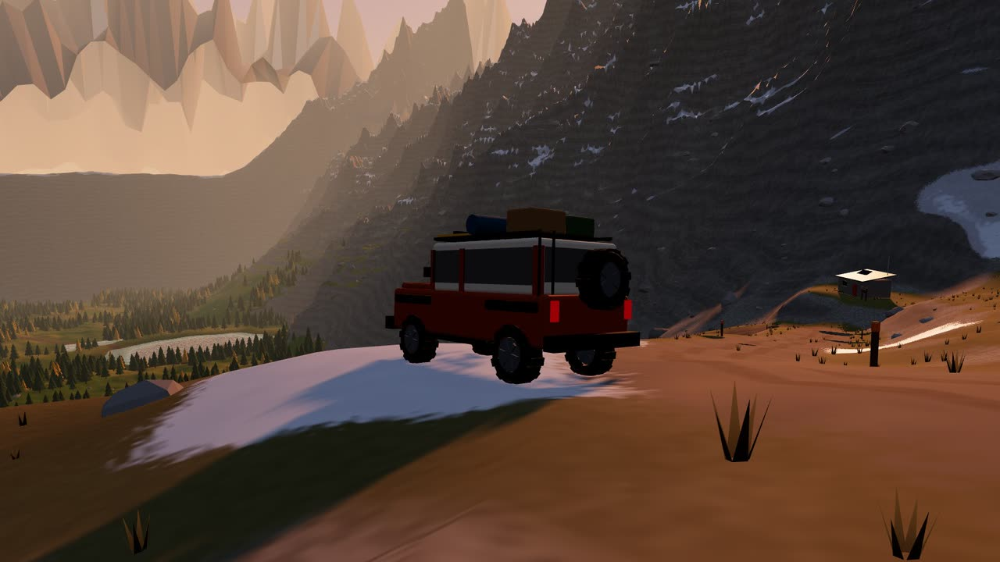
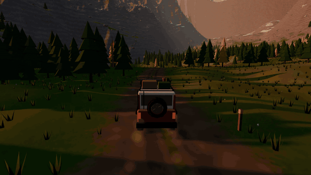
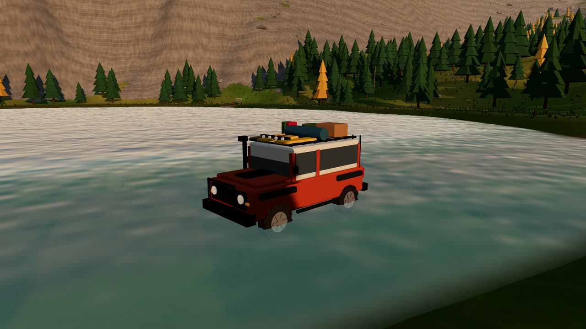
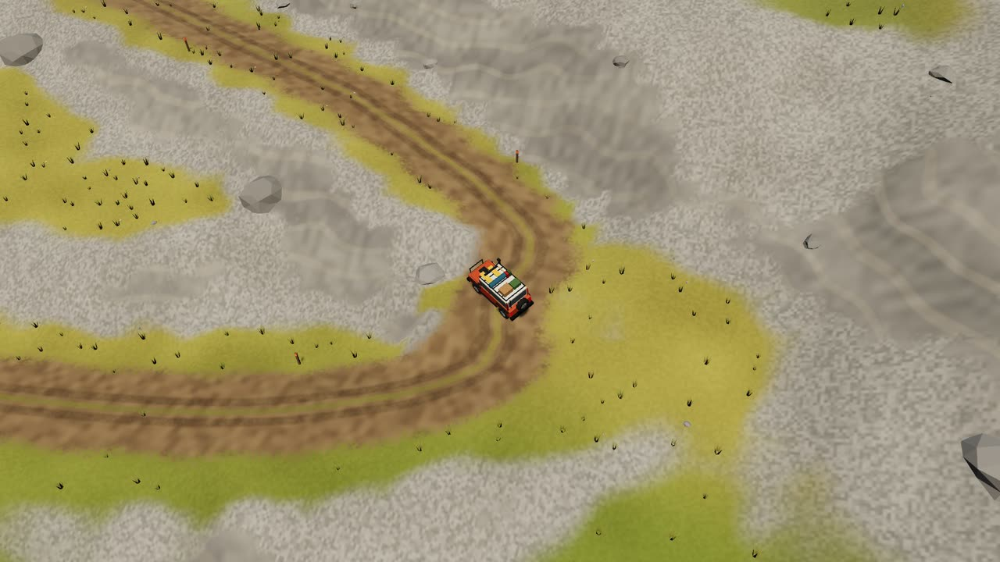
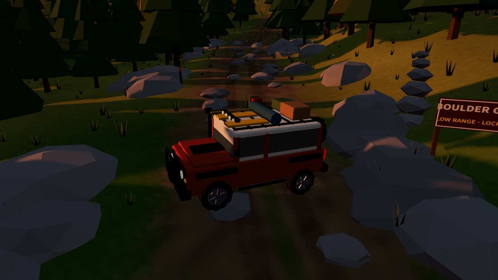
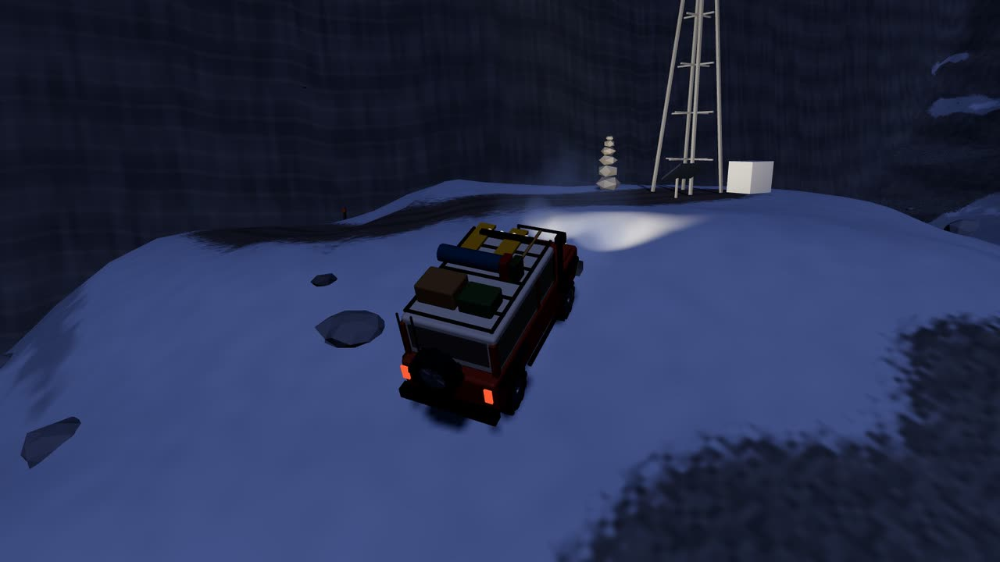
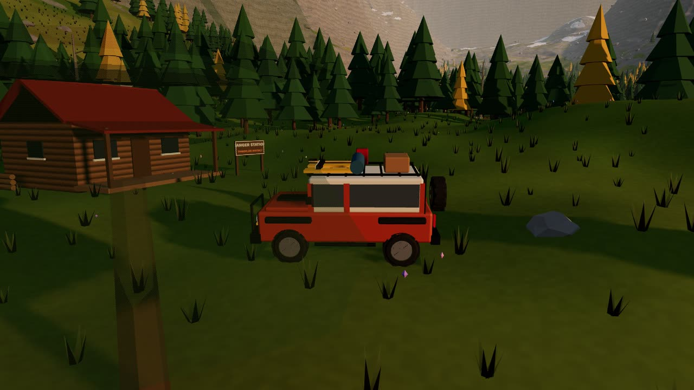
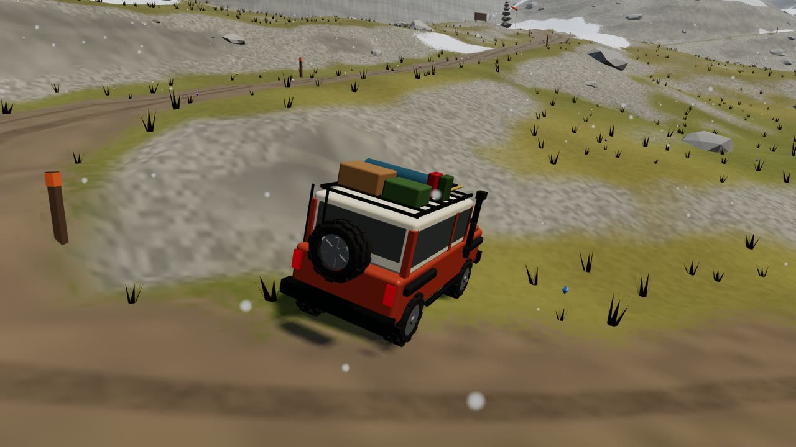
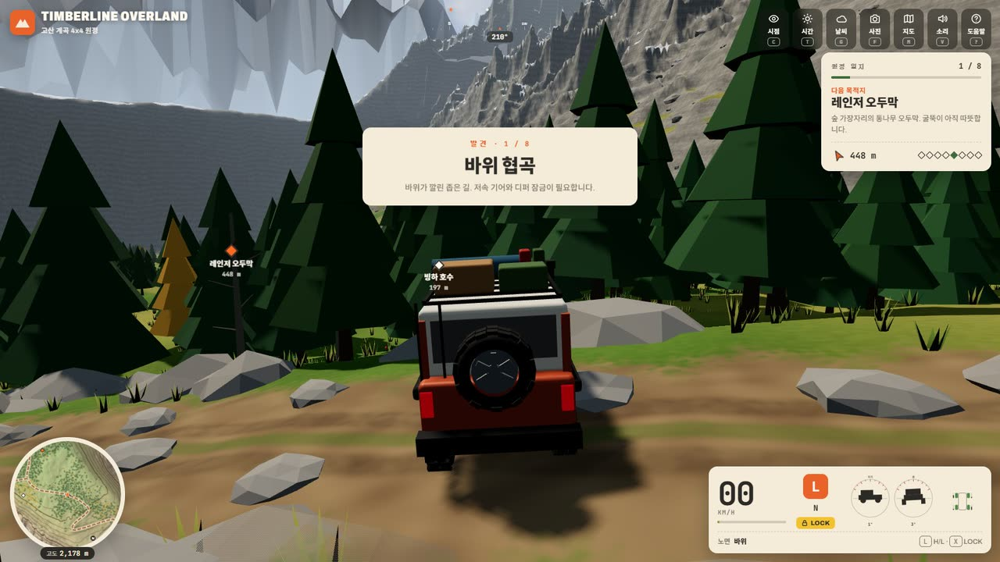
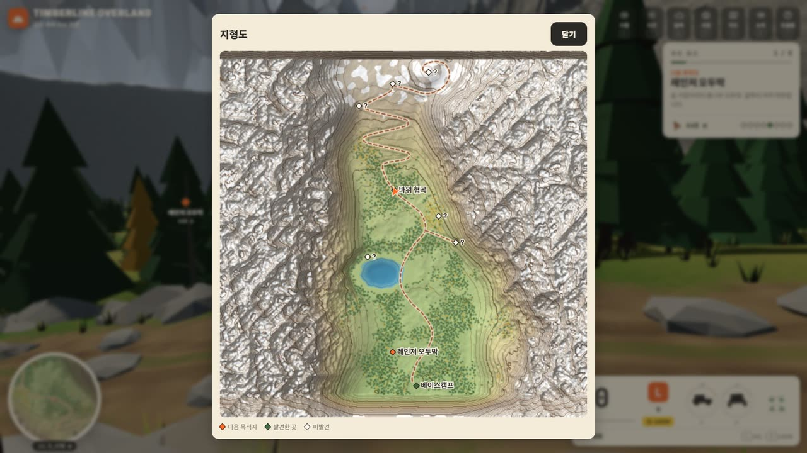

<div align="center">



# 수목한계선 원정 · Timberline Overland

**빙하가 깎아 낸 고산 계곡을 사륜구동으로 오르는, 브라우저 오프로드 원정 게임**

바위 크롤링 · 저속 기어와 디퍼렌셜 잠금 · 호수 여울 · 스위치백 · 설치·빌드 없음

<p>
  <a href="https://jeiel85.github.io/timberline-overland/"></a>
</p>
<p>
  
  
  
  
  
  <a href="https://github.com/jeiel85/timberline-overland/actions/workflows/test.yml"></a>
</p>



</div>

---

## 어떤 게임인가요

레이스가 아니라 **원정**입니다. 남쪽 베이스캠프에서 출발해 숲길과 빙하 호수의 여울을 건너고, 바위가 깔린 협곡을 기어오르고, 헤드월의 스위치백을 지나 정상 표지탑까지 — 계곡 곳곳의 **여덟 장소**를 찾아 원정 일지를 채우면 됩니다. 트레일을 벗어나 초지·너덜·눈밭을 마음대로 달려도 됩니다.

차는 **Rapier 강체 위에 직접 만든 바퀴 모델**로 움직입니다. 바퀴마다 다섯 개의 레이로 지면을 더듬어 바위 턱에 걸리고, 서스펜션이 늘어나고 줄며, 한쪽 바퀴가 뜨면 오픈 디퍼렌셜이 힘을 잃습니다. 그래서 바위 협곡은 **저속 기어(L)와 디퍼렌셜 잠금(X)** 없이는 잘 안 올라갑니다.

## 갤러리

| | |
|---|---|
|  |  |
|  |  |
|  |  |

<p align="center"></p>
<p align="center"></p>

## 특징

- **손으로 설계한 절차적 계곡** — 1 km × 1 km. U자 빙하곡, 지층이 드러난 절벽, 빙하 호수, 정상 언덕. 트레일은 스플라인으로 그린 뒤 경사를 제한(본선 25%)해 지형에 깎아 넣었습니다. 숲·바위·풀·꽃은 모두 코드로 생성합니다.
- **크롤링 물리** — Rapier 0.21 강체 + 직접 구현한 레이 샘플링 바퀴(바퀴당 5개), 롱트래블 서스펜션과 범프스톱, 안티롤바, 노면별 마찰(흙·자갈·초지·바위·너덜·눈·진흙·물), 마찰원 기반 타이어 힘, 정지 시 경사 홀드.
- **구동계** — 파트타임 4WD(센터 잠김), **고속 H / 저속 L 트랜스퍼**, **앞뒤 디퍼렌셜 잠금**. 오픈 디퍼에서는 접지가 약한 바퀴가 토크를 정하기 때문에 대각선으로 바퀴가 뜨면 멈추고, 잠그면 기어오릅니다. 저속 기어는 내리막 엔진 브레이크로 차를 붙잡습니다.
- **원정 일지** — 레인저 오두막, 빙하 호수, 옛 광산, 낙엽송 숲, 바위 협곡, 설선 대피소, 독수리 고개, 정상 표지탑. 다음 목적지·거리·방향, 나침반 띠의 표식, 월드 마커, 완주 통계(시간·거리·최대 기울기·복구 횟수). 진행 상황은 브라우저에 자동 저장됩니다.
- **계기판** — 속도·RPM, H/L, 기어, 디퍼 잠금, 노면, **피치/롤 경사계**, 바퀴별 접지·헛돎·서스펜션 압축 표시, 고도, 진행 방향이 위로 오는 등고선 미니맵.
- **시간과 날씨** — 아침·한낮·석양·밤(별, 전조등, 모닥불, 깜박이는 표지탑) × 맑음·안개·눈. 직접 작성한 하늘·구름·물 셰이더.
- **사진 모드** — 자유 궤도 카메라, 필름·흑백·엽서 필터, PNG 저장(엽서 필터는 위치와 고도를 넣은 캡션까지).
- **어디서나** — 키보드, 게임패드, 휴대폰 터치 버튼. 한국어/영어 UI. 그래픽 품질 3단계와 저사양 자동 하향.
- **앱으로 설치 (PWA)** — 타이틀의 **앱으로 설치** 버튼(Chrome·Edge·Android)이나 iOS Safari의 공유 → 홈 화면에 추가로 설치하면 전체 화면으로 실행됩니다. 한 번 접속한 뒤에는 **오프라인에서도** 플레이할 수 있습니다. 온라인일 때는 늘 최신 버전을 받아 오고, 네트워크가 없을 때만 캐시를 씁니다.
- **소리도 코드로** — 오디오 파일이 없습니다. 엔진은 AudioWorklet에서 6기통 터보 디젤의 폭발 펄스를 하나씩 만들어 배기·소음기·블록 공명에 통과시킵니다(아이들 진동, 디젤 노킹, 터보 휘슬, 관성 주행 버블). 5단 자동변속기 모델이 변속점·토크컨버터·레브 리미터로 RPM을 움직이고, 저속 기어에서는 트랜스퍼 기어 울림이 커집니다. 노면마다 다른 바퀴 소리(자갈·너덜·눈·풀·물·진흙), 헛도는 바퀴, 바위에 긁히는 차체, 짐받이 덜컹임, 충돌음, 계곡 잔향, 낮의 새소리와 밤의 풀벌레·부엉이까지 Web Audio로 합성합니다.

## 조작법

| 동작 | 키보드 | 게임패드 | 터치 |
|---|---|---|---|
| 가속 / 브레이크·후진 | `W` `S` 또는 `↑` `↓` | RT / LT | **GAS** / **BRAKE** |
| 조향 | `A` `D` 또는 `←` `→` | 왼쪽 스틱 | ◀ ▶ |
| 핸드브레이크 | `Space` | A | **HB** |
| 저속·고속 기어 | `L` | Y | **H/L** |
| 디퍼렌셜 잠금 | `X` | X | **LOCK** |
| 시점 (추적·보닛·드론, 드래그로 둘러보기) | `C` | B | **CAM** |
| 바로 세우기 · 트레일 복귀 | `R` · `Shift`+`R` | RB | **↺** (길게: 트레일 복귀) |
| 전조등 | `H` | LB | — |
| 시간 · 날씨 · 사진 · 지도 | `T` `G` `F` `M` | — · — · — · Back | 상단 버튼 |
| 소리 · 일시 정지 · 도움말 | `V` · `Esc` · `?` | — · Start · — | 상단 버튼 |

> **팁** — 바위는 `L` 저속 기어로 천천히. 한쪽 바퀴가 뜨면서 헛돌면 `X`로 디퍼렌셜을 잠그세요(시속 40km를 넘으면 자동 해제). 급한 내리막에서는 가속을 떼면 저속 기어가 차를 잡아 줍니다. 뒤집히면 `R`.

## 원정 일지 — 여덟 장소

| # | 장소 | 가는 길 |
|---|---|---|
| 1 | 레인저 오두막 | 출발 직후, 숲 가장자리로 트레일을 살짝 벗어나기 |
| 2 | 빙하 호수 | 여울을 건넌 뒤 북서쪽 기슭의 선착장 |
| 3 | 옛 광산 | 본선에서 동쪽으로 갈라지는 광산 지선 끝 |
| 4 | 낙엽송 숲 | 광산 갈림길 북동쪽, 금빛 숲 한가운데 |
| 5 | 바위 협곡 | 본선 위 — 저속 기어와 디퍼 잠금이 필요한 구간 |
| 6 | 설선 대피소 | 스위치백 서쪽 헤어핀 옆 |
| 7 | 독수리 고개 | 스위치백의 끝 |
| 8 | 정상 표지탑 | 고개에서 언덕을 감아 오르는 지선 정상 |

## 로컬에서 실행

빌드 단계가 없습니다. 정적 파일 서버만 있으면 됩니다(ES 모듈이라 `file://`로는 열리지 않습니다).

```bash
python -m http.server 8137
```

브라우저에서 `http://localhost:8137` 을 엽니다. three.js와 Rapier는 jsDelivr CDN에서 버전을 고정해 불러옵니다.

## 테스트

```bash
node --test
```

물리 엔진이나 브라우저 없이 도는 순수 모듈 테스트입니다.

- **지형** — 생성의 결정성, 트레일별 최대 경사와 횡경사, 여울 길이·깊이, 랜드마크가 마른 땅 위에 있는지, 트레일 위에 나무·바위가 없는지(협곡 바위는 높이 제한).
- **구동계** — 바퀴 하나가 뜬 오픈 디퍼, 잠긴 디퍼, 대각선 접지(오픈은 정지·잠금은 전진), 센터 잠김의 토크 이동, 저속 기어 배수와 속도 제한, 자동변속기의 변속 순서·헌팅 방지·레브 리미터.
- **엔진 합성기** — 워클릿을 오프라인으로 렌더해 신호가 유한하고 풀스케일 안인지, 폭발 주파수(rpm/20)에 음정이 맞는지, 부하에 따라 커지고 연료 차단에 작아지는지, 터보가 부스트에서 휘슬을 내는지.
- **원정 일지** — 발견 반경, 진행 순서, 완료 시 시계 정지, 저장·복원.
- **PWA** — 서비스 워커의 사전 캐시 목록이 `src/`의 모든 모듈·import map의 CDN 주소·실제 사용하는 three.js 애드온과 일치하는지, 매니페스트 아이콘이 실제 PNG 크기와 맞는지.
- **저장 데이터** — 이전 버전 저장본, 깨진 JSON, 손으로 고친 값(알 수 없는 시간대·품질·좌표)이 기본값으로 안전하게 돌아오는지.

푸시와 PR마다 GitHub Actions가 같은 테스트를 돌립니다.

## 구조

```
index.html          HUD·오버레이 마크업과 스타일, import map
manifest.webmanifest · sw.js · icons/   설치 정보, 오프라인 캐시(서비스 워커), 앱 아이콘
src/
  layout.js         트레일 제어점, 호수, 정상 언덕, 랜드마크 배치
  terrain.js        높이장 생성, 트레일 깎기, 재질 가중치, 노면 조회 (순수)
  scatter.js        나무·바위·협곡 바위·풀·꽃 배치 (순수)
  drivetrain.js     엔진 곡선, H/L, 오픈/잠금 디퍼렌셜 분배 (순수)
  journal.js        원정 일지 진행·통계·저장 (순수)
  save.js           저장 데이터 버전·필드 검증 (순수)
  vehicle.js        Rapier 강체 + 레이 샘플링 바퀴, 서스펜션, 타이어 힘
  physics.js        높이필드·볼록 껍질 바위·나무 기둥·건물 충돌체
  world.js          지형 셰이더, 호수, 하늘 돔, 원경 산맥, 시간·날씨 프리셋
  flora.js          타일 단위 인스턴싱 식생, 카메라 시선 디더링
  props.js          랜드마크 건물과 표지판
  carmodel.js       원정용 4x4 모델
  audio.js          사운드 믹서: 노면·헛돎·긁힘·충돌·바람·잔향·야생 소리
  engine-worklet.js 엔진 합성기 (AudioWorklet, 폭발 펄스 + 공명)
  camera.js · hud.js · input.js · fx.js · i18n.js · main.js
tests/              node --test
```

## 만든 계기

Threads에서 본 "AI와 함께 만든 브라우저 3D 오프로드 게임" 영상에 자극받아, 같은 장르를 **처음부터 새로** 만들었습니다. 지형·차량·건물·소리 모두 이 저장소의 코드로 생성하며, 외부 게임의 에셋이나 코드는 쓰지 않았습니다.

---

## English

**Timberline Overland** is an alpine 4x4 expedition you play in the browser. Start at base camp, ford the glacier tarn, crawl through a boulder gully, climb the switchbacks and reach the summit beacon — find all eight places to complete the expedition log, or just roam off-trail.

- Hand-designed procedural valley (1 km²) with grade-limited trails carved into the terrain.
- Rapier rigid body with custom ray-sampled wheels, long-travel suspension, surface-dependent friction.
- Part-time 4WD with **high/low range** and **locking differentials** — open diffs stall on cross-axle articulation, locked ones climb.
- Expedition log, pitch/roll inclinometer, per-wheel traction display, heading-up topo minimap and a paper map.
- Time of day (morning, noon, golden hour, night) × weather (clear, mist, snow), photo mode with filters.
- Keyboard, gamepad and touch; Korean and English UI; zero external assets.
- Synthesized sound: an AudioWorklet turbo-diesel built from firing pulses through exhaust resonances, an automatic gearbox driving the revs, per-surface tyre textures, scrapes, impacts, valley reverb and wildlife.

Installable as a PWA (full screen, playable offline after the first visit).

**Play:** https://jeiel85.github.io/timberline-overland/ — **Run locally:** `python -m http.server 8137` — **Tests:** `node --test`

## 라이선스

[MIT](LICENSE)
